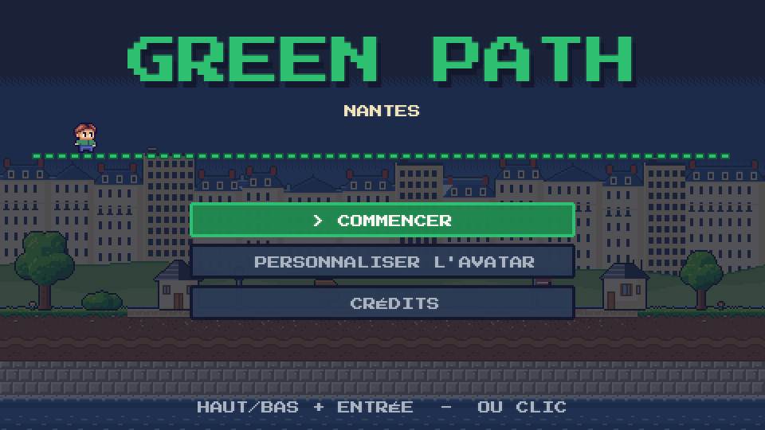
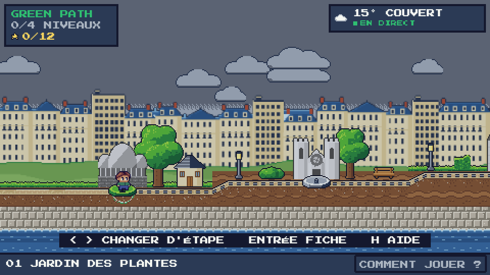
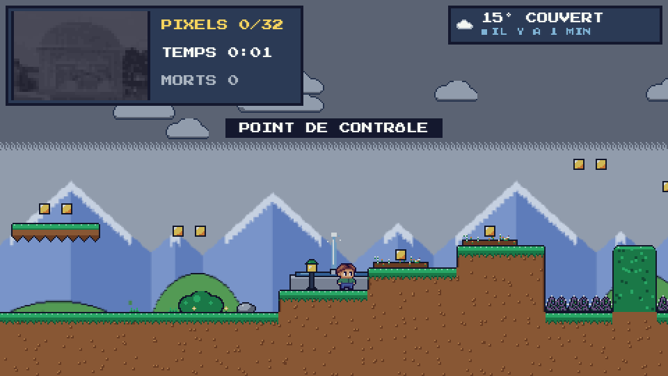
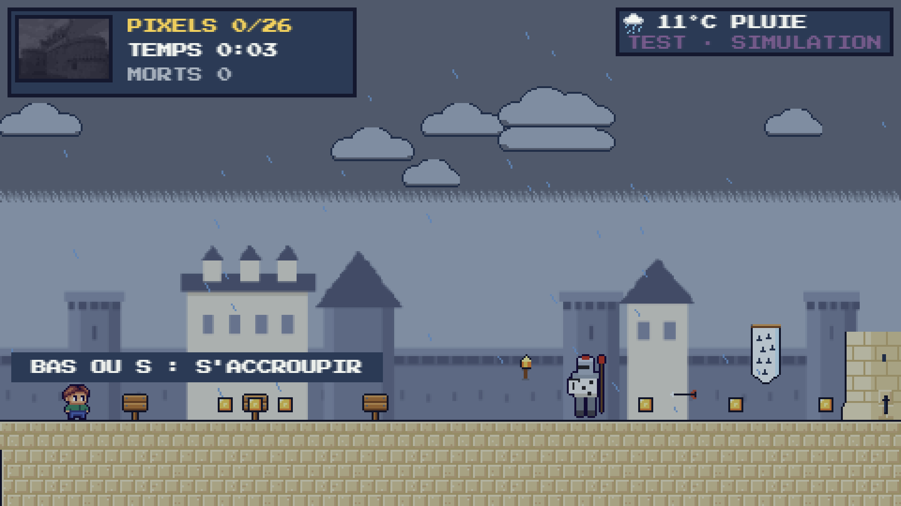
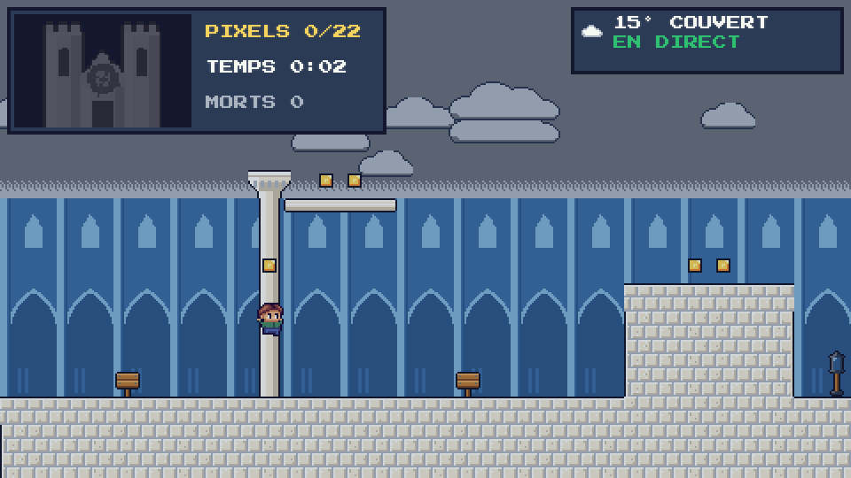
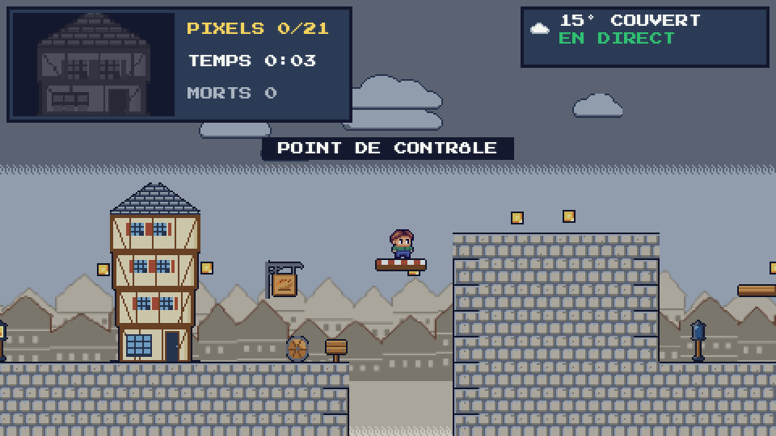
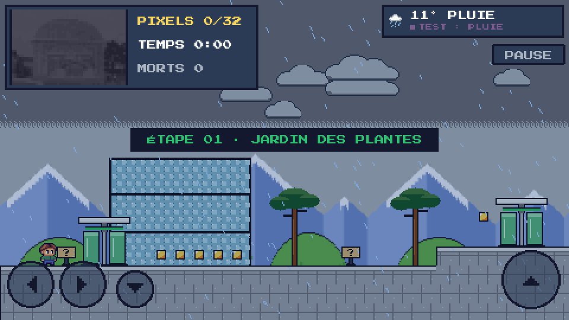
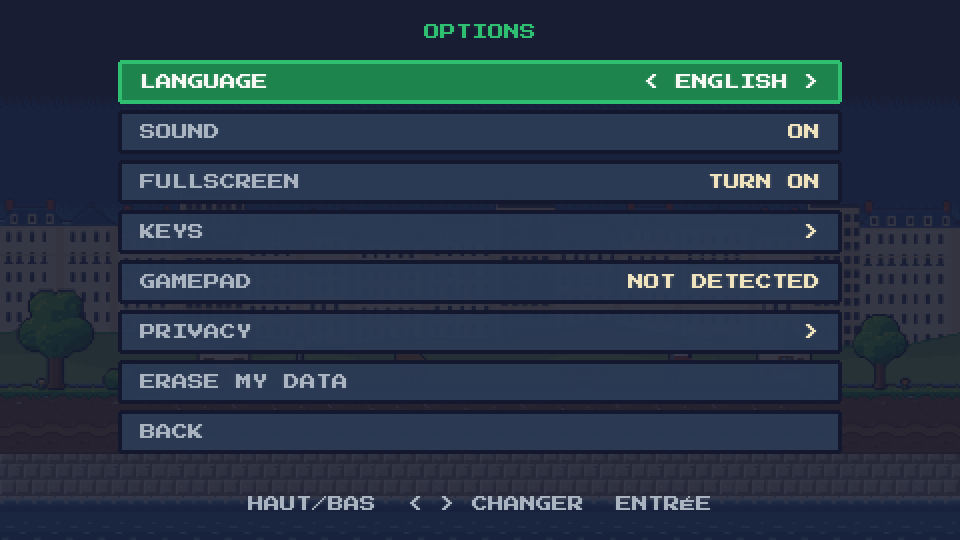
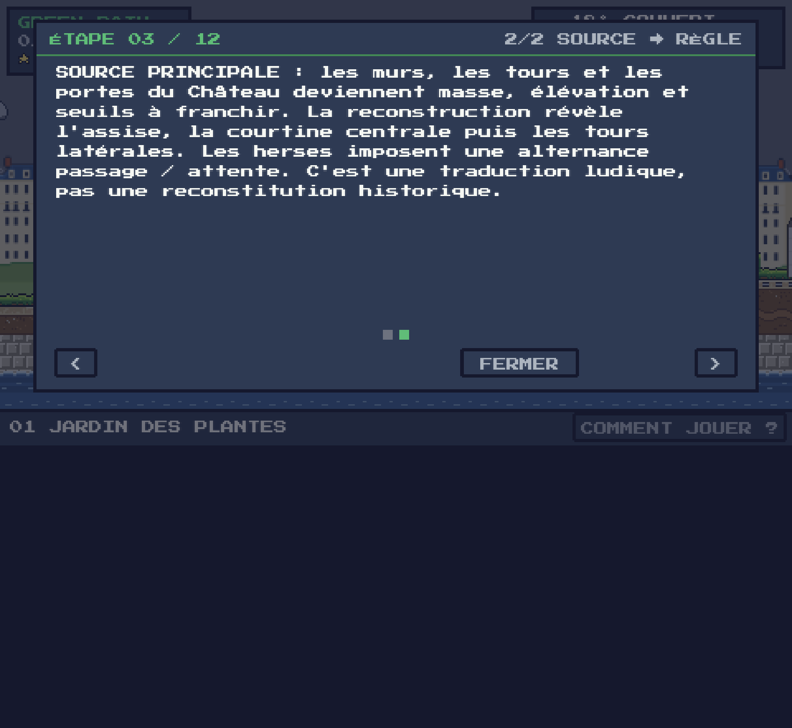

# Green Path — Nantes en mille pixels

**Les 12 niveaux sont implémentés à partir des GZones**, avec les boss des niveaux 6, 9 et 12. Version **0.5-gzones** : travail à tester et retoucher, pas douze validations humaines. **Sélecteur local : http://127.0.0.1:8130/tools/levels.html** (outil de développement non publié). En production, utiliser la carte et le déverrouillage normal. Suivi actuel : [docs/LEVEL_REDESIGN.md](docs/LEVEL_REDESIGN.md). Les documents d'audit du 10 novembre décrivent le socle antérieur : [AUDIT.md](AUDIT.md), [GAME_DESIGN.md](GAME_DESIGN.md), [HERITAGE_GRAMMAR.md](HERITAGE_GRAMMAR.md), [ROADMAP.md](ROADMAP.md).

**Finition UX/UI et corrections** : commandes adaptatives, remapping, carte réversible avec montée sur les piédestaux, terminaisons ciblées, trois rubriques À propos, Options aéré, fiche et transition centrées. Détail : [docs/UX_POLISH.md](docs/UX_POLISH.md). **Météo abritée livrée localement** : [docs/WEATHER_SHELTERS.md](docs/WEATHER_SHELTERS.md). Protocole silencieux, relevé volontaire et configuration d'équilibrage : [docs/PLAYTEST_REPORT.md](docs/PLAYTEST_REPORT.md) ; aucun playtest humain revendiqué. Les autres évolutions de [docs/GAMEPLAY_UPGRADES.md](docs/GAMEPLAY_UPGRADES.md) restent des propositions.

**Refonte des douze niveaux** : Jardin/Cathédrale suivent désormais leurs JSON ; le Château conserve son adaptation. Les autres niveaux intègrent balcons, flotteurs, rebonds, mécanismes industriels, anneaux, conteneurs, dalles, séquences et courants ascendants. Réussite = image complète **puis arche** ; pour 6/9/12, le boss doit également être neutralisé. La publication sur l'adresse officielle est autorisée par l'utilisateur ; les captures ci-dessous restent celles de la version antérieure. Les nouveaux exports sont dans `docs/screenshots/level-*.png`.

> *« Psst… par ici ! Je suis le gardien de la ligne verte. Cette nuit, un grand coup de vent a soufflé sur Nantes. Ses monuments se sont envolés en mille pixels ! »*

Un jeu de plateforme pixel art qui suit la **ligne verte** de Nantes. De lieu en lieu, tu cours, tu sautes, tu grimpes et tu ramasses les pixels qui reconstruisent, case après case, chaque monument. **La vraie météo de Nantes change le jeu** : précipitations et vent agissent sur les espaces exposés ; l'architecture couverte protège le parcours.

**▶ Jouer : https://green-path-game.vercel.app** (ordinateur, ou téléphone tenu en paysage)



| La carte du monde | 1 · Jardin des Plantes |
|---|---|
|  |  |
| **3 · Château** : s'accroupir sous les flèches (ici sous la pluie) | **2 · Cathédrale** : grimper aux colonnes, s'accrocher aux rebords |
|  |  |
| **Prototype Bouffay (hors parcours)** : les étals bougent | **Sur téléphone, en paysage** |
|  |  |

## Le concept
- **Une archive qui se reconstruit** : chaque niveau cache des pixels. Chacun ramassé révèle un morceau de la photo du lieu (48×32 cases, 16 couleurs), dans un ordre propre au lieu : le Jardin des Plantes pousse **du bas vers le haut**, comme une plante.
- **Une ligne verte à suivre** : sur la carte, le chemin s'allume en vert à chaque lieu terminé, et le monument passe du gris à la couleur.
- **Trois étoiles par niveau** : image complète, sans mourir, sous le temps cible.
- **La vraie météo de Nantes** (Open-Meteo, mise à jour toutes les 5 min) change l'environnement et les niveaux réagissent, avec une annonce à l'entrée de chaque niveau :

  | Météo à Nantes | Dans Green Path |
  |---|---|
  | Pluie, bruine, orage | sol exposé plus glissant ; balcons à entraînement ; parasols alourdis ; précipitations masquées sous les couvertures |
  | Neige | inertie accrue dehors, jets du Jardin gelés en appuis, flotteurs moins enfoncés, premier rebond des parasols plus faible |
  | Vent fort | le vent pousse les sauts dans sa direction ; Château et Bouffay : les tonneaux roulent plus vite |
  | Brume | voile clair, les pixels ne se voient que de près |
  | Nuit | ciel étoilé, lanternes allumées, pixels visibles un peu moins loin |
  | Grand soleil | parasols plus élastiques à Graslin ; variation bornée des mécanismes mobiles |

  Les **275 fragments** font l'objet de diagnostics physiques dont les limites sont documentées : téléportations à des surfaces candidates, morts neutralisées et interactions d'anneaux prises en compte. Cela ne prouve pas une traversée complète et connectée avec dangers par un humain. Le Château dispose en plus de traversées scriptées ; ne pas étendre leur résultat aux onze autres parcours.
- **Abris** : passages du Château, nef de la Cathédrale, atelier, hangar, verrière de Pommeraye et galerie du Mémorial. Protections et géométrie visibles partagées avec le masque de précipitations ; pas de bulle sèche autour du joueur. Le nouveau Jardin n'importe pas les auvents de son ancien prototype.
- **Ton avatar** : coiffure, yeux, peau, tenue, chaussures, ou un des 8 modèles.
- **La carte postale de fin** : une fois les 12 lieux terminés, le jeu offre une carte postale PNG (1800 × 1200 px) de Nantes reconstruite : les monuments le long de la ligne verte, ton avatar, le ciel et la météo réelle de Nantes **au moment où tu as fini**, ta phrase (« Nantes reconstruite le 12 novembre, sous un ciel couvert, 34 étoiles sur 36. »), ton pseudo facultatif. Elle se fabrique dans le navigateur, rien n'est envoyé ; elle se revoit depuis le menu (MA CARTE) avec la météo du jour de la fin. Spécification : [docs/spec-carte-postale.md](docs/spec-carte-postale.md) ; code : `js/systems/Postcard.js`, `js/scenes/PostcardScene.js`.

## Les 12 lieux
L'ordre suit la séquence de la page [« Arpenter la ligne verte »](https://www.levoyageanantes.fr/les-parcours/arpenter-la-ligne-verte/) du Voyage à Nantes pour les lieux qui y figurent (Jardin des Plantes, Cathédrale, Château, Machines, Chantiers, Buren, Mémorial, Pommeraye), complétée pour les autres. Cette page ne donne aucune numérotation : **l'ordre des 12 étapes est une sélection pour le jeu, ce n'est pas la numérotation officielle de la ligne verte.**

| # | Lieu | Statut | Ce qu'on y apprend |
|---|---|---|---|
| 1 | Jardin des Plantes | à tester localement | allées, bassins, jets et topiaires |
| 2 | Cathédrale Saint-Pierre-et-Saint-Paul | à tester localement | colonnes, accroche, nef couverte, galeries et toits |
| 3 | Château des ducs de Bretagne | ✅ jouable | **s'accroupir** sous les flèches, tonneaux, herses, douves |
| 4 | Île Feydeau | à tester localement | balcons inclinés et bateaux flotteurs |
| 5 | Place Graslin | à tester localement | parasols rebondissants et lustres |
| 6 | Machines de l'île (Grand Éléphant) | à tester localement | engrenages, bielles, vapeur et boss à valves |
| 7 | Parc des Chantiers (Grue Titan) | à tester localement | chariots au poids et ascenseur |
| 8 | Anneaux de Buren | à tester localement | impulsions et chaînes d'anneaux |
| 9 | Hangar à Bananes | à tester localement | conteneurs, portes basses, boss à lampes UV |
| 10 | Passage Pommeraye | à tester localement | trois strates, dalles fragiles et lustres |
| 11 | Mémorial de l'abolition de l'esclavage | à tester localement | séquences de dalles et eau lente |
| 12 | Tour LU (Lieu Unique) | à tester localement | courants ascendants et boss à quatre lanternes |

*Un niveau « Bouffay » (étals mobiles) existe dans `js/data/levels.js` mais n'est rattaché à aucun lieu pour l'instant.*

L'ordre local suit les GZones : **Pommeraye 10, Mémorial 11**. Les sauvegardes restent liées aux identifiants de lieux ; seule l'ancienne sélection d'indice 9/10 est permutée une fois. Les reprises des parcours remplacés sont invalidées par révision, pas les résultats déjà terminés.

## Commandes
| Carte | Niveau |
|---|---|
| ← → ou A D : lieu précédent / suivant | ← → ou Q/A D : courir |
| Entrée / Espace : fiche du lieu, JOUER | Espace, W ou Z : sauter (maintenir = plus haut) |
| Clic sur un piédestal : y aller | ↓ ou S : s'accroupir · ↑ : grimper, se hisser sur un rebord |
| H ou **COMMENT JOUER ?** : aide en 4 pages | Échap : pause (reprendre, aide, quitter) |
| Échap : menu · M : son | Téléphone : ← → ↓ et saut à l'écran (le saut sert aussi à grimper), PAUSE |
| **Manette** : croix ou stick, A valider | **Manette** : croix ou stick = bouger, A = sauter, ↓ = s'accroupir, ↑ = grimper, Start = pause |

**Ressenti du saut** (réglage `feel-1`, inspiré de Celeste, voir `docs/ressenti.md`) : le sommet du saut flotte un peu tant que la touche est maintenue, un coin de plafond ne bloque plus net (la tête glisse de 1 à 4 px), un rebord frôlé de moins de 8 px est gravi tout seul, on peut sauter depuis l'accroupi (le personnage se relève d'abord), et accroché à un rebord on se hisse aussi en poussant de nouveau vers le mur.

Ronces, pointes, flèches, gouttes, tonneaux ou chute = une mort : retour à la dernière lanterne allumée, les pixels ramassés sont gardés.

**Reprise locale** : les fragments d'un niveau en cours et la dernière lanterne sont maintenant sauvegardés. Après fermeture ou rafraîchissement, le niveau reprend à ce point sûr, image partiellement reconstruite, temps et morts conservés. Une partie terminée se rejoue depuis le début. Les reprises intra-niveau restent sur cet appareil, contrairement aux résultats terminés qui peuvent être synchronisés avec un compte facultatif.

Le bouton **PAUSE** à l'écran n'existe que sur écran tactile : au clavier c'est Échap, à la manette Start.

Sur téléphone, le jeu se joue **en paysage** : tenu en portrait, un écran demande de le tourner et le jeu se met en pause.

## Options, langues, manette, plein écran
- **Langues** : français (source) et anglais. Bouton **FR/EN** en haut à droite de l'accueil (touche L), ou **OPTIONS → LANGUE**. Un navigateur non français démarre en anglais.
- **OPTIONS** : langue, son, plein écran, **animations** (Auto = suit le système, Activées ou Réduites ; en mouvement réduit l'avatar de l'accueil attend au milieu de la ligne), **touches réaffectables** (3 emplacements par action : gauche, droite, sauter, grimper, s'accroupir ; Échap, Entrée, H et M restent réservées), état de la manette, confidentialité, effacement de ses données.
- **Deux groupes Options** : JEU ET COMMANDES / DONNÉES ET AIDE, clic ou Tab (LB/RB à la manette). **À propos** propose trois rubriques distinctes : Crédits, Confidentialité, Sources et licences, avec pages de lecture et retour à l'écran d'origine.
- **Manette** (API Gamepad, aucune installation) : branche-la et appuie sur un bouton. Croix ou stick = bouger ; A = sauter / valider ; B = retour ; Start = pause. Elle pilote aussi les menus.
- **Dernier périphérique utilisé** : une vraie touche ou un clic réaffiche le clavier ; une nouvelle pression manette ou un stick engagé réaffiche ses boutons, sans fermer l'écran ouvert. Connexion seule et dérive du stick ne basculent pas l'interface. Y = aide, LB/RB = pages ; X = son sur la carte/en jeu, aperçu dans l'avatar, rejouer au résultat. Les libellés Sony sont adaptés si le modèle est reconnu. Le livre affiche les touches de jeu réellement configurées ; les menus gardent leur navigation propre.
- **OPTIONS → COMMANDES** : vue clavier avec les 3 emplacements configurables ou vue manette des correspondances fixes. Les dialogues de compte se parcourent à la manette (invité compris) ; taper pseudo/code requiert toujours un clavier ou le clavier système.
- **Carte** : gauche/droite inverse le trajet dès la frame suivante, même entre deux étapes. Un clic peut changer la destination sans saut de position.
- **Téléphone, plein écran** : la zone de jeu s'élargit pour remplir tout l'écran (de 16:9 jusqu'à 21:9, sans bandes noires). Android et iPad : plein écran au premier toucher (ou OPTIONS → PLEIN ÉCRAN). **iPhone** : Safari n'a pas de plein écran ; touche Partager puis « Sur l'écran d'accueil » (le jeu est installable, `manifest.webmanifest`).
- **Pseudo, sauvegarde en ligne et classement** (facultatifs, **sans e-mail**) : après le premier niveau terminé, le jeu propose **créer un pseudo**, **retrouver une sauvegarde avec son code** ou **jouer en invité** (mode par défaut, tout reste sur l'appareil). Avec un pseudo, tu reçois un **code secret de 20 caractères** (à noter : seul moyen de retrouver ta sauvegarde sur un autre appareil) ; ta progression et ton avatar sont enregistrés après chaque niveau, et le **CLASSEMENT** (menu) affiche pseudo, étoiles et temps. Gestion dans **OPTIONS → COMPTE** (synchroniser, se déconnecter, supprimer son compte). Hors ligne ou serveur indisponible : le jeu continue, le classement affiche la dernière version vue. Détails techniques : [supabase/README.md](supabase/README.md).
- **Confidentialité (RGPD)** : aucune donnée personnelle sans pseudo ; avec pseudo, seulement pseudo, avatar, progression et haché du code, avec accord explicite, serveurs dans l'UE (Paris). Page dans le jeu (CRÉDITS ou OPTIONS) et détail dans [docs/confidentialite.md](docs/confidentialite.md).



## Lancer en local
Aucun gestionnaire de paquets ni build à installer. Phaser 3.90 et la police sont déjà inclus. Ouvrir `index.html` directement (compatibilité `file://` prévue par les scripts classiques ; non retestée lors de cet audit), ou, de préférence, servir le dossier avec Python 3 :
```bash
python3 -m http.server 8123
```
puis http://localhost:8123. **Mode test** : ajouter `?dev=1` à l'adresse (W : météos simulées sur la carte, N dans un niveau ; K : ramasser tous les pixels).

### Tester directement les douze niveaux

```bash
python3 -m http.server 8130 --bind 127.0.0.1
```

Ouvrir **http://127.0.0.1:8130/tools/levels.html**, puis choisir un niveau. Exemple : **http://127.0.0.1:8130/?dev=1&level=chateau**. Ces lancements sont réservés à localhost : sauvegarde `greenpath.dev.<lieu>`, compte cloud non chargé, progression normale non débloquée par l'essai.

- Contrôles de jeu habituels ; **N** : neuf météos simulées dont orage, puis météo réelle ; **V** : inverser le vent courant ; **R** : recommencer le parcours de test.
- **K** sert seulement à vérifier l'arche avec tous les fragments : ce n'est pas un test de collecte. Même après K, rejoindre l'arche reste nécessaire.
- Parcourir les cinq zones, essayer un retour vers un fragment manquant, la reprise aux lanternes et les passages couverts sous pluie/neige.
- Les JSON de Jardin/Cathédrale étaient les seules références disponibles et sont maintenant interprétés par le moteur ; aucune autre version jouable externe n'a été fournie.

Recette automatisée reproductible et limites : [tests/README.md](tests/README.md). Les boss approuvés se neutralisent par valves, lampes UV ou lanternes, pas en les frappant. K ne permet pas de contourner leur victoire. Les retouches se feront sur les retours de l'utilisateur, conformément à sa nouvelle demande de réaliser l'ensemble avant validation.

## Fallback et limites connues
- **Hors ligne** : le dossier complet lancé avec un serveur local ne dépend pas d'Internet. Sur le site hébergé en HTTPS, une **première visite complète** prépare une copie locale (service worker, `sw.js`) qui permet ensuite le rechargement sans réseau. Il est impossible de charger un site jamais visité sans réseau. **Chaque publication change le nom du cache** (`node tools/bump-sw.cjs` avant `npx vercel --prod`) : sans cela, un navigateur déjà venu garde l'ancienne copie du jeu ; avec, la page se recharge d'elle-même une fois (sauf en plein niveau). Le cache ne contient que les fichiers publics, jamais les échanges météo/compte. Attendre la fin de l'installation avant de passer en mode avion ; vérifier avec `await GP.offlineReady` dans la console. `?dev=1` ne lance pas cette installation.
- Si l'API coupe, le jeu garde **la dernière météo reçue** (widget « HORS LIGNE ») ; sinon météo **NEUTRE** sans effet ([data/fallback.json](data/fallback.json), copie documentaire des valeurs JS, non chargée par le moteur). Le widget affiche deux lignes ; le mode test indique « TEST · SIMULATION ». Les réponses incomplètes ou non numériques sont rejetées. Progression dans `localStorage`, ou en mémoire jusqu'à fermeture si le stockage est bloqué.
- La météo est redemandée toutes les 5 min, et dès que le réseau revient.
- **Carte postale** : sans Internet (ou avec la météo de secours), la carte se télécharge quand même, sans mention de la météo. Une partie terminée avant la mise en ligne de la carte reçoit sa carte à la première ouverture de MA CARTE, avec la météo de ce moment-là. Rendu net contrôlé à l'écran (neuf météos, clair/sombre), pas encore sur iOS/Android.
- Images à reconstruire : photo pixélisée validée pour le Jardin des Plantes ; pour les autres lieux, le monument de la planche de sprites en attendant des photos Commons validées.
- **Difficulté** : courbe d'obstacles rééquilibrée le 11 novembre ([docs/equilibrage.md](docs/equilibrage.md), `node tools/balance.cjs`), mesurée sur les données et **jamais validée par des joueurs**.
- Douze versions de travail et trois boss ; Bouffay reste détaché. Aucun nouvel atlas ni illustration-récompense finale ajouté. Les outils de test et le sélecteur de développement restent exclus de la publication Vercel.
- La provenance/licence de la référence de l'avatar reste à clarifier avant diffusion large. Les notices secondaires demandent encore une vérification documentaire.
- Le mode tactile est conçu pour le paysage ; le canvas n'est pas entièrement accessible aux lecteurs d'écran. Les tests de fenêtre responsive ne remplacent pas un vrai essai iOS/Android.

## Source, grammaire et mapping
Le **Château des ducs de Bretagne** est la source patrimoniale principale, les onze autres lieux un corpus de variations. Masse → murs, seuil → herse, élévation → tours ; reconstruction géométrique assise → centre → côtés. Ce masque stylisé ne constitue pas un relevé architectural. Les fiches des trois lieux expliquent désormais la relation **SOURCE → RÈGLE** (clavier ou boutons de pagination).

Au moins trois paramètres ont un effet réel : collecte → groupes de cellules révélés ; pluie/neige → accélération et réactions locales ; vent normalisé → poussée aérienne ; brume/nuit → visibilité. Valeurs, limites, références et droits : [HERITAGE_GRAMMAR.md](HERITAGE_GRAMMAR.md). La température est affichée, pas utilisée pour teinter le jeu.

## Tester
Node.js 18+ pour les tests seulement (aucune installation npm) :
```bash
node --test tests/*.test.js
node tools/compare-figma.js
node tools/solvability.cjs   # chaque niveau est-il finissable ? (docs/methode-niveaux.md)
```
Tests Phaser reproductibles et procédures offline/responsive : [tests/README.md](tests/README.md). Il n'existe pas de commande de build : le livrable est le dossier statique. Aucun déploiement ni changement de base distant n'a été exécuté pendant l'audit. Pour Vercel : conserver `vercel.json`, publier uniquement avec l'accord de l'équipe ; augmenter la version de cache de `sw.js` lors d'une nouvelle livraison de fichiers. Un ancien onglet doit être fermé pour laisser la nouvelle copie s'activer.

Dernière recette locale : 57 tests Node (dont l'équilibrage) ; par format 1920×1080, 1366×768 et 844×390, 73 contrôles de régression + 97 de polish + 24 du socle, tous réussis. Neuf diagnostics géométriques réussis. Les simulations DOM/Gamepad et fenêtres CSS ne remplacent ni un test humain ni un appareil réel. `js/data/tuning.js` centralise les valeurs existantes sans changer arbitrairement la difficulté.

## Stack
Phaser 3.90 (inclus en local), JavaScript natif en scripts classiques (pas de build, compatible `file://`), police Press Start 2P, résolution 480×270 agrandie sans lissage. Le décor vient de planches de sprites en texte (une lettre = une couleur d'une palette de 35) transformées en textures au démarrage ; les fonds du Jardin et du Château, les silhouettes, les plantes et les salles intérieures sont dessinés par code (`GP.PixelArt`, `js/systems/LevelArt.js`). Déploiement statique sur Vercel.

```
index.html               page, icônes, écran « tournez votre téléphone »
js/config.js             réglages, palette, mode test (?dev=1)
js/data/                 locations.js (12 lieux), levels.js (niveaux), sprites/ (planches importées), lang/ (fr.js, en.js)
js/systems/              I18n (FR/EN), Settings (langue, touches), Controls (entrées), Prompts (périphérique et commandes affichées), MapTravel (trajet réversible), Cloud + Account (pseudo, sauvegarde, classement Supabase), Sprites, MapArt (carte), LevelArt (ciel, décor), WeatherManager / WeatherFX / WeatherRules (météo en direct → règles de jeu),
                         PixelCollection (photo à reconstruire), Save / Progression / Stars, Ui (fenêtres, aide, tactile)
js/scenes/               Boot, Menu, Character (avatar), Options, Score (classement), Map, Game (moteur de plateforme), Result
assets/                  police, logo et icônes, photos pixélisées (assets/locations/*.js)
supabase/                schema.sql et README (base du pseudo, de la sauvegarde et du classement)
tools/                   import-sprites.js, pixelize.swift, favicon.swift, compare-figma.js, bot.js (tests)
```

## Contributions
- **Florine RACINE** — UX/UI Designer, Game Design · **Loan PLEURMEAU** — Développeur web, IA Ops (ESD Nantes, atelier PATRIMOINE.EXE).

## AI usage
Le code initial a été assisté par Claude Code sous la direction de l'équipe ; les planches de décor ont été générées avec Claude Design, l'avatar provient du fichier Figma fourni.
GPT-6.1 Sol via OpenCode a réalisé l'audit puis le polish UX/UI, écrit les correctifs, les tests et la documentation ; les skills Phaser ont servi de référence sans migration vers Phaser 4.
Les vérifications réellement exécutées et leurs limites figurent dans `AUDIT.md` ; aucune contribution individuelle ni observation d'utilisateur n'a été inventée.
L'équipe doit relire, comprendre et pouvoir défendre le code livré ; les informations historiques et les droits restant incertains sont explicitement signalés.

## Sources et droits
- Photo du Palmarium : Pymouss44, CC BY-SA 3.0, via Wikimedia Commons, recadrée et pixélisée. Données météo : Open-Meteo (CC BY 4.0). Police Press Start 2P (OFL). Phaser (MIT).
- Silhouettes du Jardin : dessins originaux de l'équipe, **inspirés** des sculptures colorées de l'été au Jardin des Plantes (personnages de Jean Jullien, oiseau en topiaire) ; aucune photo ni image des œuvres n'est reprise.
- Détails, licences et obligations : [CREDITS.md](CREDITS.md).


