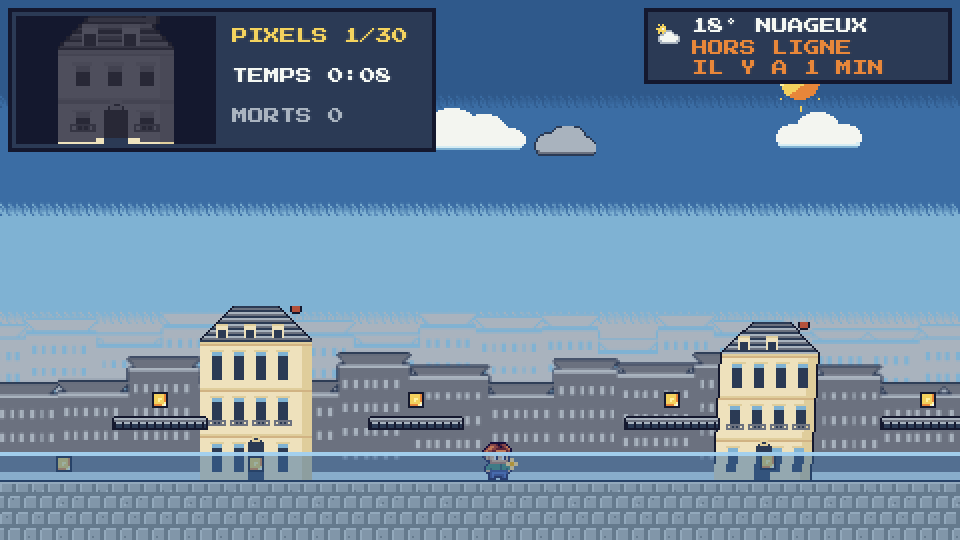
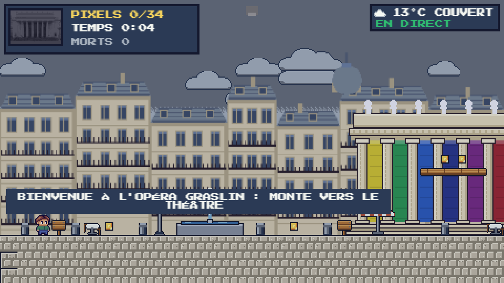
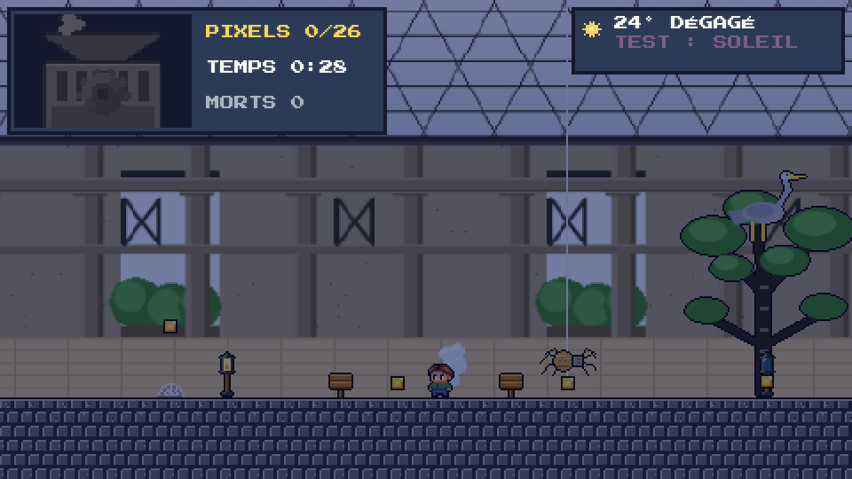
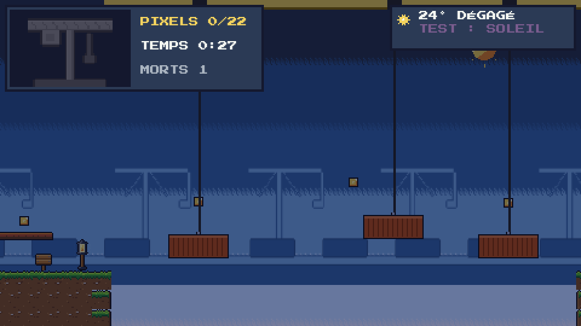
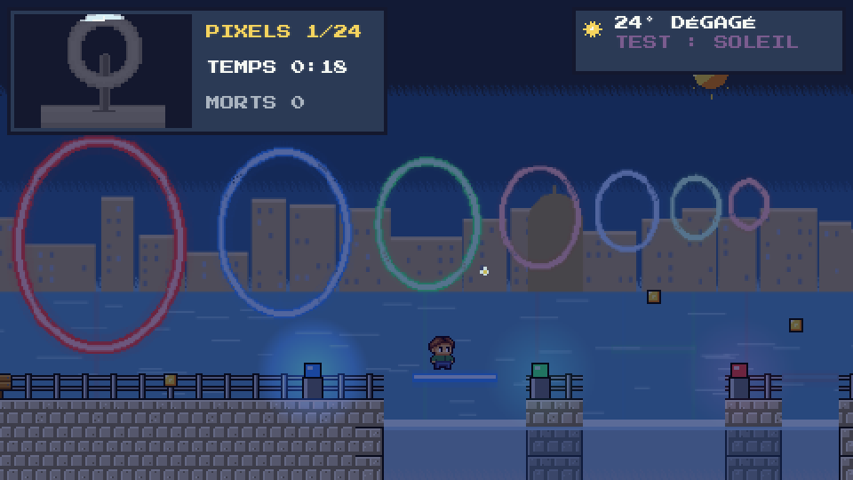
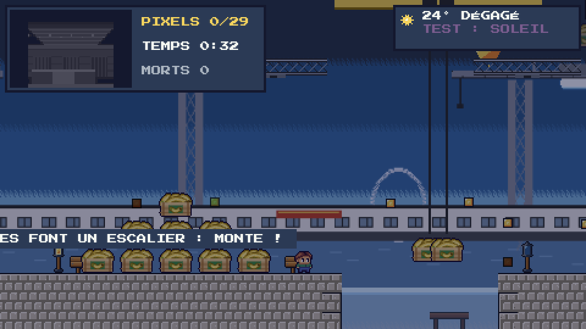
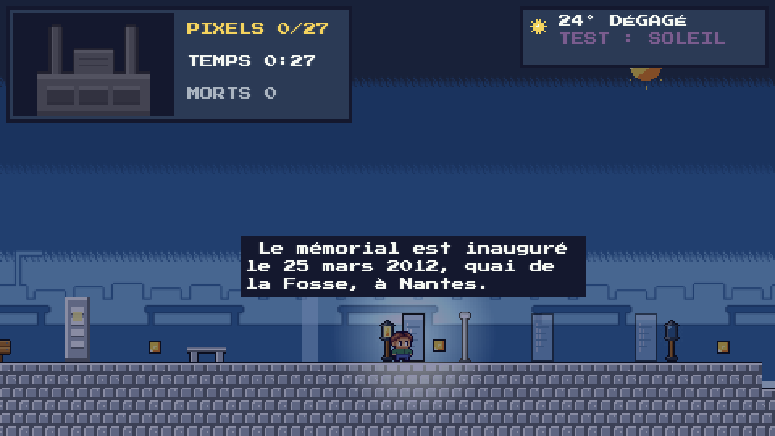
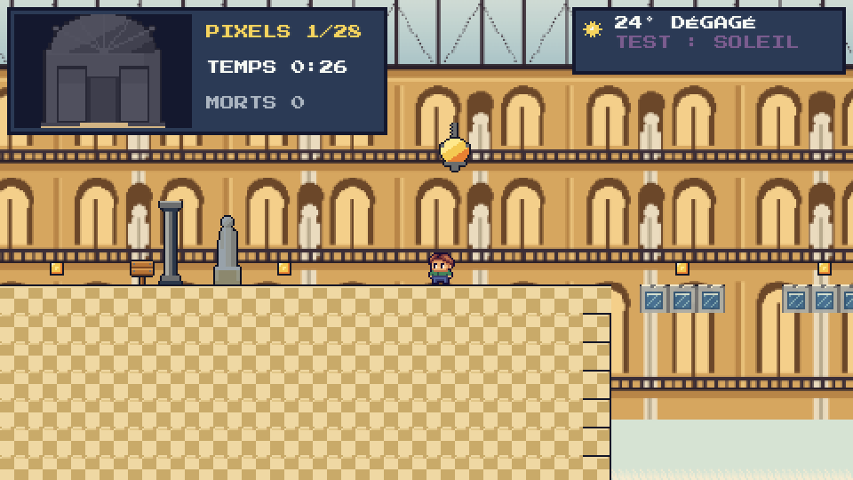
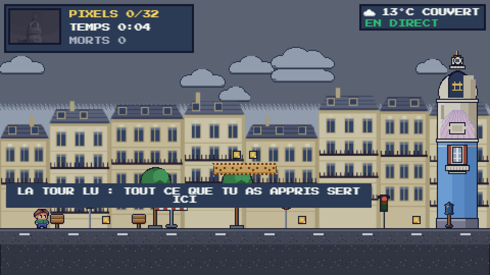

# Green Path — Nantes en mille pixels

> *« Psst… par ici ! Je suis le gardien de la ligne verte. Cette nuit, un grand coup de vent a soufflé sur Nantes. Ses monuments se sont envolés en mille pixels ! »*

Un jeu de plateforme pixel art qui suit la **ligne verte** de Nantes. De lieu en lieu, tu cours, tu sautes, tu grimpes et tu ramasses les pixels qui reconstruisent, case après case, chaque monument. **La vraie météo de Nantes change le jeu** : s'il pleut à Nantes, il pleut dans Green Path, le sol glisse et les ronces poussent.

**▶ Jouer : https://green-path-sepia.vercel.app** (ordinateur, ou téléphone tenu en paysage)


| La carte du monde | 1 · Jardin des Plantes |
|---|---|
|  |  |
| **2 · Cathédrale** : grimper aux colonnes, s'accrocher aux rebords | **3 · Château** : du châtelet aux herses à la salle des gardes, en intérieur |
|  |  |
| **4 · Bouffay** : les étals bougent | **Sur téléphone, en paysage** |
|  |  |

| **4 · Île Feydeau** : la marée monte, les bateaux s'enfoncent, les visages des façades mentent | **5 · Place Graslin** : les Muses lancent des notes, parasols qui font rebondir, projecteurs, rideau à ouvrir |
|---|---|
|  |  |
| **6 · Machines de l'île** : rails qui entraînent, jets de vapeur, araignées (au sol ou suspendues à un fil) qui se figent quand on les regarde, et le **Grand Éléphant** sur lequel on monte pour traverser le canal | **7 · Parc des Chantiers** : conteneurs qui tombent de la grue (l'ombre prévient), chariots |
|  |  |
| **8 · Anneaux de Buren** : des **bornes de couleur** allument les passerelles néon de leur couleur au-dessus de la Loire | **9 · Hangar à Bananes** : les pixels pourrissent, la moisissure gagne du terrain |
|  |  |
| **10 · Mémorial** : sobre, sans ennemi : une stèle à lire, une porte de lumière, du verre qui se fissure | **11 · Passage Pommeraye** : l'escalier monumental, la verrière, les ponts de verre |
|  |  |
| **12 · Tour LU** : tout ce qu'on a appris, puis le courant d'air ascendant de la coupole | |
|  | |

## Le concept
- **Une archive qui se reconstruit** : chaque niveau cache des pixels. Chacun ramassé révèle un morceau de la photo du lieu (48×32 cases, 16 couleurs), dans un ordre propre au lieu : le Jardin des Plantes pousse **du bas vers le haut**, comme une plante.
- **Une ligne verte à suivre** : sur la carte, le chemin s'allume en vert à chaque lieu terminé, et le monument passe du gris à la couleur.
- **Des rencontres** : une fois un niveau terminé, un petit personnage apparaît près du monument sur la carte (Anne de Bretagne, Jules Verne enfant, Louis Pommeraye, un docker…) ; la fiche du lieu a une page **RENCONTRE** avec son anecdote et sa source (un simple panneau au Mémorial). Sources dans [docs/sources.md](docs/sources.md).
- **Trois étoiles par niveau** : image complète, sans mourir, sous le temps cible.
- **La vraie météo de Nantes** (Open-Meteo, mise à jour toutes les 5 min) change l'environnement et les niveaux réagissent, avec une annonce à l'entrée de chaque niveau :

  | Météo à Nantes | Dans Green Path |
  |---|---|
  | Pluie, bruine, orage | pluie à l'écran, le sol glisse ; Jardin : des ronces poussent ; Cathédrale : les gargouilles coulent plus souvent |
  | Neige | flocons, on dérape (plus d'inertie) |
  | Vent fort | le vent pousse les sauts dans sa direction ; Château et Bouffay : les tonneaux roulent plus vite |
  | Brume | voile clair, les pixels ne se voient que de près |
  | Nuit | ciel étoilé, lanternes allumées, pixels visibles un peu moins loin |
  | Grand soleil | Jardin : des fleurs deviennent des plateformes (raccourcis) |

  Chaque effet est borné : on peut toujours contrer le vent, et chaque niveau reste finissable (vérifié par script sous pluie, vent et neige).

  Réactions propres à chaque lieu (annoncées à l'entrée du niveau) :

  | Lieu | Pluie | Soleil | Vent |
  |---|---|---|---|
  | Jardin | ronces qui poussent | fleurs-plateformes | |
  | Cathédrale | gargouilles plus fréquentes | | |
  | Château | esprits de la garde plus lents | esprits plus agités | tonneaux plus rapides |
  | Île Feydeau | la marée monte plus haut | la marée reste basse | les bateaux coulent plus vite |
  | Place Graslin | notes de Muse plus lentes | projecteurs plus rapides | parasols : rebond plus haut |
  | Machines de l'île | jets plus courts | araignées plus rapides | |
  | Parc des Chantiers | cale plus vive | chariots plus rapides | conteneurs plus fréquents |
  | Anneaux de Buren | la couleur d'une borne ne reste allumée que 5 s | | |
  | Hangar à Bananes | pixels plus lents à pourrir, moisissure plus vive | pixels plus rapides à pourrir, moisissure plus lente | |
  | Mémorial | marée un peu plus haute, verre plus fragile | marée basse, verre qui revient vite | |
  | Passage Pommeraye | verre plus fragile | verre qui revient plus vite | |
  | Tour LU | tapis plus vifs | jets de vapeur plus longs | parasol : rebond plus haut |
- **Un décor propre à chaque lieu** : le **Jardin des Plantes** est un vrai parc (rangées d'arbres, magnolias, massifs, hortensias, hautes herbes) où l'on croise des silhouettes colorées inspirées des sculptures de l'été au jardin ; le **Château** se traverse de la cour, avec ses tours de schiste et son logis blanc en tuffeau, jusqu'aux **salles intérieures** (châtelet aux herses, puis salle des gardes avec sa cheminée). Tout est dessiné par code, sans image externe.
- **Un danger propre à chaque lieu** : ronces et mauvaises herbes au Jardin, fissures de voûte qui suintent à la Cathédrale, esprits de la garde au Château, eau qui monte et visages menteurs à l'Île Feydeau, Muses qui lancent des notes et projecteurs à Graslin, jets, araignées qui se figent et Grand Éléphant à monter aux Machines, conteneurs qui tombent aux Chantiers, bornes de couleur à Buren, pourriture des pixels et moisissure au Hangar, une stèle à lire et rien d'hostile au Mémorial, verre qui se fissure à la Pommeraye, courant d'air qui allège la gravité à la Tour LU. Un signe (ombre, souffle, tremblement) précède toujours le danger.
- **Ton avatar** : coiffure, yeux, peau, tenue, chaussures, ou un des 8 modèles.

## Les 12 lieux
L'ordre suit la séquence de la page [« Arpenter la ligne verte »](https://www.levoyageanantes.fr/les-parcours/arpenter-la-ligne-verte/) du Voyage à Nantes pour les lieux qui y figurent (Jardin des Plantes, Cathédrale, Château, Machines, Chantiers, Buren, Mémorial, Pommeraye), complétée pour les autres. Cette page ne donne aucune numérotation : **l'ordre des 12 étapes est une sélection pour le jeu, ce n'est pas la numérotation officielle de la ligne verte.**

| # | Lieu | Statut | Ce qu'on y apprend |
|---|---|---|---|
| 1 | Jardin des Plantes | ✅ jouable | courir, sauter, ronces, lanternes |
| 2 | Cathédrale Saint-Pierre-et-Saint-Paul | ✅ jouable | **grimper** aux colonnes, **s'accrocher** aux rebords, gargouilles, corniches qui s'effritent |
| 3 | Château des ducs de Bretagne | ✅ jouable | **s'accroupir** sous les flèches, tonneaux, herses, douves |
| 4 | Île Feydeau | ✅ jouable | **la marée monte** (se mettre au sec), **bateaux qui s'enfoncent**, **visages sculptés qui mentent** (faux indices) |
| 5 | Place Graslin | ✅ jouable | **parasols** qui font rebondir, **Muses** qui lancent des notes, **projecteurs** qui balaient, **rideau** à ouvrir en rejouant une séquence |
| 6 | Machines de l'île (Grand Éléphant) | ✅ jouable | **rails et tapis** qui entraînent, **jets de vapeur** (le souffle prévient), **petits robots** qui poursuivent |
| 7 | Parc des Chantiers (Grue Titan) | ✅ jouable | **conteneurs qui tombent** (l'ombre prévient), **chariots** qui avancent quand on monte dessus, cale qui entraîne en arrière |
| 8 | Anneaux de Buren | ✅ jouable | **bornes de couleur** (bleu, vert, rouge) qui allument les passerelles de leur couleur ; décor de jour ou de nuit selon la météo, garde-corps du quai |
| 9 | Hangar à Bananes | ✅ jouable | **pourriture** : chaque pixel est vert, jaune (à récolter), brun, puis s'efface avant de repousser ; **moisissure** qui gagne du terrain sur le sol |
| 10 | Mémorial de l'abolition de l'esclavage | ✅ jouable | niveau **sobre, sans ennemi** : lire une **stèle** puis rejouer sa séquence (bas, haut) devant une porte de lumière, **verre** qui se fissure, marée calme |
| 11 | Passage Pommeraye | ✅ jouable | niveau **vertical** : escalier monumental, **verre** de la verrière qui se fissure (0,8 s), lustres qui balancent |
| 12 | Tour LU (Lieu Unique) | ✅ jouable | toutes les mécaniques reprises, puis le **courant d'air ascendant** de la coupole (saut jusqu'à 7 tuiles) ; pas de boss |

*Un niveau « Bouffay » (étals mobiles) existe dans `js/data/levels.js` mais n'est rattaché à aucun lieu pour l'instant.*

## Commandes
| Carte | Niveau |
|---|---|
| ← → ou A D : lieu précédent / suivant | ← → ou Q/A D : courir |
| Entrée / Espace : fiche du lieu, JOUER | Espace, W ou Z : sauter (maintenir = plus haut) |
| Clic sur un piédestal : y aller | ↓ ou S : s'accroupir · ↑ : grimper, se hisser sur un rebord |
| H ou **COMMENT JOUER ?** : aide en 4 pages | Échap : pause (reprendre, aide, quitter) |
| Échap : menu · M : son | Téléphone : ← → ↓ et saut à l'écran (le saut sert aussi à grimper), PAUSE |
| **Manette** : croix ou stick, A valider | **Manette** : croix ou stick = bouger, A = sauter, ↓ = s'accroupir, ↑ = grimper, Start = pause |

Ronces, pointes, flèches, gouttes, tonneaux ou chute = une mort : retour à la dernière lanterne allumée, les pixels ramassés sont gardés.

**Limite de temps (douce)** : un niveau s'arrête après **3 min** de jeu (3 min 20 à 4 min pour les niveaux plus longs : Feydeau, Graslin, Machines, Chantiers, Hangar), pour qu'il ne dure jamais indéfiniment. Un message prévient 30 secondes avant (sans clignotement), puis l'écran **TEMPS ÉCOULÉ** propose REJOUER (R) ou la CARTE : rien n'est enregistré (ni étoile, ni étape débloquée). Le temps passé en pause n'est pas compté.

Sur téléphone, le jeu se joue **en paysage** : tenu en portrait, un écran demande de le tourner et le jeu se met en pause.

## Options, langues, manette, plein écran
- **Langues** : français (source) et anglais. Bouton **FR/EN** en haut à droite de l'accueil (touche L), ou **OPTIONS → LANGUE**. Un navigateur non français démarre en anglais.
- **OPTIONS** : langue, son, plein écran, **touches réaffectables** (3 emplacements par action : gauche, droite, sauter, grimper, s'accroupir ; Échap, Entrée, H et M restent réservées), état de la manette, confidentialité, effacement de ses données.
- **Manette** (API Gamepad, aucune installation) : branche-la et appuie sur un bouton. Croix ou stick = bouger ; A = sauter / valider ; B = retour ; Start = pause. Elle pilote aussi les menus.
- **Téléphone, plein écran** : la zone de jeu s'élargit pour remplir tout l'écran (de 16:9 jusqu'à 21:9, sans bandes noires). Android et iPad : plein écran au premier toucher (ou OPTIONS → PLEIN ÉCRAN). **iPhone** : Safari n'a pas de plein écran ; touche Partager puis « Sur l'écran d'accueil » (le jeu est installable, `manifest.webmanifest`).
- **Pseudo, sauvegarde en ligne et classement** (facultatifs, **sans e-mail**) : après le premier niveau terminé, le jeu propose **créer un pseudo**, **retrouver une sauvegarde avec son code** ou **jouer en invité** (mode par défaut, tout reste sur l'appareil). Avec un pseudo, tu reçois un **code secret de 20 caractères** (à noter : seul moyen de retrouver ta sauvegarde sur un autre appareil) ; ta progression et ton avatar sont enregistrés après chaque niveau, et le **CLASSEMENT** (menu) affiche pseudo, étoiles et temps. Gestion dans **OPTIONS → COMPTE** (synchroniser, se déconnecter, supprimer son compte). Hors ligne ou serveur indisponible : le jeu continue, le classement affiche la dernière version vue. Détails techniques : [supabase/README.md](supabase/README.md).
- **Confidentialité (RGPD)** : aucune donnée personnelle sans pseudo ; avec pseudo, seulement pseudo, avatar, progression et haché du code, avec accord explicite, serveurs dans l'UE (Paris). Page dans le jeu (CRÉDITS ou OPTIONS) et détail dans [docs/confidentialite.md](docs/confidentialite.md).


## Lancer en local
Aucun build, aucune dépendance : ouvrir `index.html` dans un navigateur (fonctionne en `file://`), ou servir le dossier :
```bash
python3 -m http.server 8123
```
puis http://localhost:8123. **Mode test** : ajouter `?dev=1` à l'adresse (W : météos simulées sur la carte, N dans un niveau ; K : ramasser tous les pixels).

## Fallback et limites connues
- **Hors ligne, le jeu reste entièrement jouable** (météo, sauvegarde locale ; le classement affiche la dernière version vue ; la sauvegarde en ligne repart au retour du réseau) : si le réseau coupe, le jeu garde **la dernière météo reçue** (widget « HORS LIGNE · IL Y A N MIN ») ; si aucune n'a jamais été reçue, météo neutre sans effet ([data/fallback.json](data/fallback.json)). La progression est gardée dans le navigateur (`localStorage`).
- La météo est redemandée toutes les 5 min, et dès que le réseau revient.
- Images à reconstruire : photo pixélisée validée pour le Jardin des Plantes ; pour les autres lieux, le monument de la planche de sprites en attendant des photos Commons validées.
- Les 12 lieux sont jouables. Les niveaux 4 à 12 sont un premier jet : positions, temps cibles et difficulté à régler au test croisé ; aucun n'a encore été joué à la main de bout en bout (les mécaniques et l'accessibilité des pixels ont été vérifiées par script).

## Stack
Phaser 3.90 (inclus en local), JavaScript natif en scripts classiques (pas de build, compatible `file://`), police Press Start 2P, résolution 480×270 agrandie sans lissage. Le décor vient de planches de sprites en texte (une lettre = une couleur d'une palette de 35) transformées en textures au démarrage ; les fonds du Jardin et du Château, les silhouettes, les plantes et les salles intérieures sont dessinés par code (`GP.PixelArt`, `js/systems/LevelArt.js`). Déploiement statique sur Vercel.

```
index.html               page, icônes, écran « tournez votre téléphone »
js/config.js             réglages, palette, mode test (?dev=1)
js/data/                 locations.js (12 lieux), levels.js (niveaux 1 à 3 et Bouffay), levels-ville.js (niveaux 4 à 12), sprites/ (planches importées), lang/ (fr.js, en.js)
js/systems/              Dangers (ennemis, pièges et mécaniques des niveaux 4 à 12), I18n (FR/EN), Settings (langue, touches), Controls (clavier réaffectable, manette), Cloud + Account (pseudo, sauvegarde, classement Supabase), Sprites, MapArt (carte), LevelArt (ciel, décors, fonds de parc et de château, salles intérieures), WeatherManager / WeatherFX / WeatherRules (météo en direct → règles de jeu),
                         PixelCollection (photo à reconstruire), Save / Progression / Stars, Ui (fenêtres, aide, tactile)
js/scenes/               Boot, Menu, Character (avatar), Options, Score (classement), Map, Game (moteur de plateforme), Result
assets/                  police, logo et icônes, photos pixélisées (assets/locations/*.js)
supabase/                schema.sql et README (base du pseudo, de la sauvegarde et du classement)
tools/                   import-sprites.js, pixelize.swift, favicon.swift, compare-figma.js, bot.js (tests)
```

## Crédits et IA
- **Florine RACINE** — UX/UI Designer, Game Design · **Loan PLEURMEAU** — Développeur web, IA Ops (ESD Nantes, atelier PATRIMOINE.EXE).
- **Usage de l'IA** : le code a été écrit avec Claude Code (Anthropic) sous la direction de l'équipe, qui le relit et sait l'expliquer (des *skills* Phaser, lus avant installation, servent de référence pour éviter les bugs 2D courants) ; les planches de sprites de décor ont été générées avec Claude Design puis importées telles quelles ; le sprite de l'avatar vient du fichier Figma de l'équipe.
- Photo du Palmarium : Pymouss44, CC BY-SA 3.0, via Wikimedia Commons, recadrée et pixélisée. Données météo : Open-Meteo (CC BY 4.0). Police Press Start 2P (OFL). Phaser (MIT).
- Silhouettes du Jardin : dessins originaux de l'équipe, **inspirés** des sculptures colorées de l'été au Jardin des Plantes (personnages de Jean Jullien, oiseau en topiaire) ; aucune photo ni image des œuvres n'est reprise.
- Détails, licences et obligations : [CREDITS.md](CREDITS.md).
