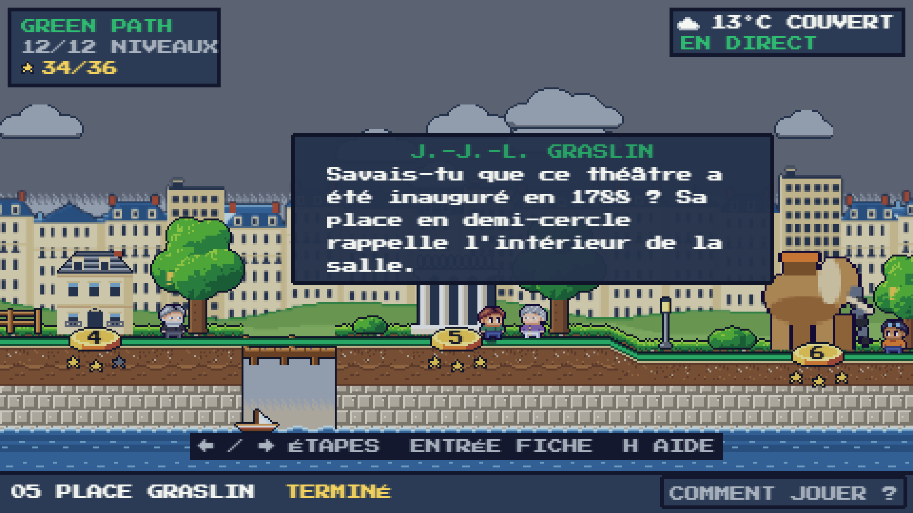
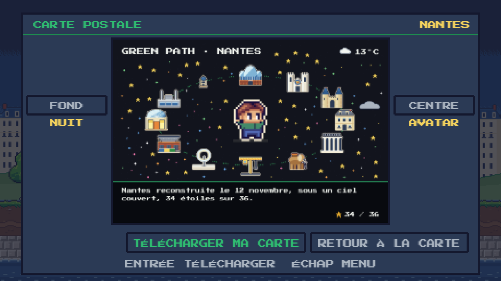
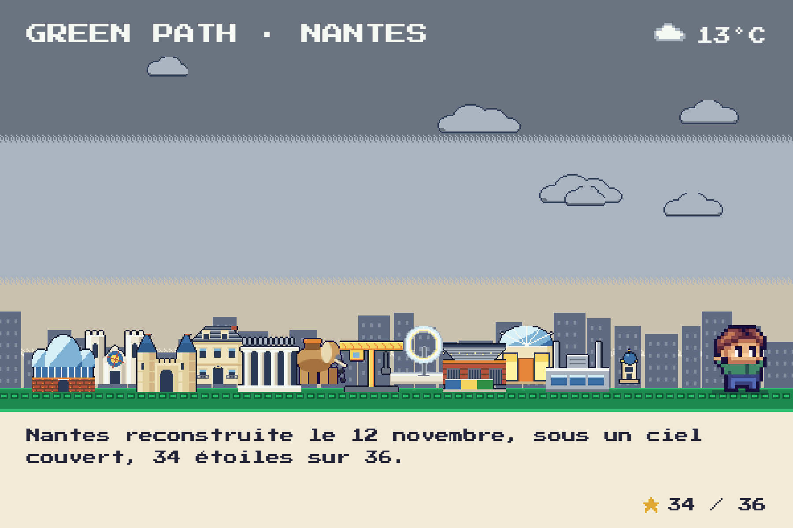
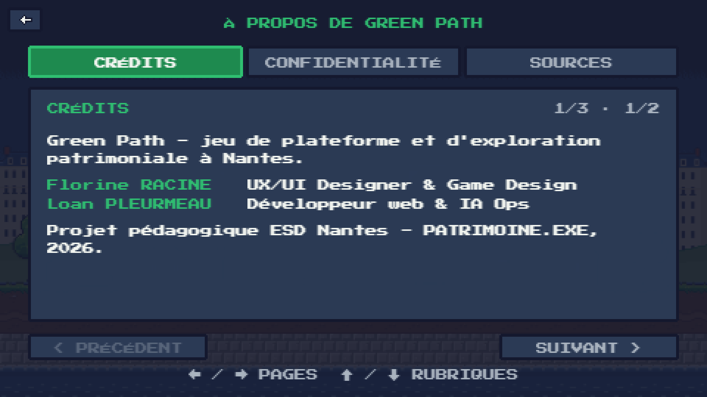

# 🟢 Green Path — Nantes en mille pixels

> *« Psst… par ici ! Je suis le gardien de la ligne verte. Cette nuit, un grand coup de vent a soufflé sur Nantes. Ses monuments se sont envolés en mille pixels ! »*

**Un jeu de plateforme pixel art qui reconstruit le patrimoine de Nantes, pixel par pixel, sous la vraie météo de la ville.**
Suis la ligne verte, du Jardin des Plantes à la Tour LU : cours, saute, grimpe, ramasse les pixels et regarde chaque monument retrouver ses couleurs.

### ▶ [Jouer maintenant : green-path-game.vercel.app](https://green-path-game.vercel.app)
Ordinateur, ou téléphone tenu en paysage · clavier, tactile ou manette · français et anglais · sans compte, même hors ligne


## Pourquoi on y revient
- 🌦️ **La météo de Nantes entre dans le jeu.** Il pleut à Nantes ? Le sol glisse et la pluie tombe dans ton niveau. Du vent ? Il pousse tes sauts. Nuit ou brume ? Les pixels se voient moins loin.
- 🏰 **12 lieux, 12 manières de jouer** : tonneaux et herses au Château, colonnes à escalader à la Cathédrale, parasols qui font rebondir à Graslin, le Grand Éléphant des Machines de l'île… et 3 boss.
- 🗣️ **Des rencontres.** Anne de Bretagne, Jules Verne, un docker… s'arrêtent pour te dire « Savais-tu que… » quand tu passes devant eux sur la carte.
- ⭐ **Trois étoiles par niveau** : image complète, sans mourir, sous le temps cible.
- 🎵 **Une ambiance musicale douce** (originale, désactivable) et un avatar à personnaliser.
- 💌 **Une carte postale de Nantes reconstruite** à la fin, en planche d'autocollants, avec ton avatar et la météo du jour.
- 🔒 **Un niveau secret** pour celles et ceux qui décrochent les 36 étoiles.

| La carte du monde | Une rencontre |
|---|---|
|  |  |
| **Jardin des Plantes** (niveau 1) | **Château** sous la pluie (niveau 3) |
|  |  |
| **Cathédrale** (niveau 2) | **Place Graslin** (niveau 5) |
|  |  |
| **Machines de l'île** (niveau 6) | **Tour LU** (niveau 12) |
|  |  |

À la fin du dernier niveau, tu arrives directement sur ta **carte postale de Nantes**, une planche d'autocollants fabriquée dans ton navigateur (1800 × 1200 px) : tu choisis le fond et ce qui trône au centre (un monument ou ton avatar), tu ajoutes ton nom, tu la télécharges.

| L'écran de la carte postale | La carte postale téléchargée |
|---|---|
|  |  |

Projet noté ESD Nantes (B3), atelier PATRIMOINE.EXE / NANTES 001 — Florine RACINE (UX/UI, game design) et Loan PLEURMEAU (développement web, IA Ops). Version **0.6**, gel fonctionnel le jeudi 12 novembre 2026 à midi. Dépôt : https://github.com/LoanPleurmeauBonnin/green-path

## Livrables PATRIMOINE.EXE
| Livrable | Où |
|---|---|
| Webapp (principal) | https://green-path-game.vercel.app |
| Fiche-source patrimoniale (12 lieux) | [docs/fiche-source.md](docs/fiche-source.md) |
| Grammaire extraite et 3 paramètres opératoires | [docs/grammaire.md](docs/grammaire.md), [HERITAGE_GRAMMAR.md](HERITAGE_GRAMMAR.md) |
| Problématique et direction créative | [docs/problematique-direction.md](docs/problematique-direction.md) |
| Sketch minimal p5.js | [sketch/](sketch/) |
| Architecture du code | section « Architecture du code » ci-dessous |
| Mapping data / API | section « Source, grammaire et mapping » |
| Fallback local (hors ligne) | section « Fallback et limites connues » |
| Test croisé silencieux | [docs/test-croise.md](docs/test-croise.md) |
| Manifest, cartel (12 patrimoines) | [manifest.json](manifest.json), [CARTEL.md](CARTEL.md) |
| Captation (hero, détail, process, démo 23 s, vignette) | [captation/](captation/) |
| Droits, crédits, sources | [CREDITS.md](CREDITS.md), [docs/sources.md](docs/sources.md), [docs/images-candidates.md](docs/images-candidates.md) |
| Carnet de bord (décisions, itérations) | [docs/carnet-de-bord.md](docs/carnet-de-bord.md) |

## Le concept
- **Une archive qui se reconstruit** : chaque niveau cache des pixels. Chacun ramassé révèle un morceau de l'image du lieu (48×32 cases, 16 couleurs), dans un ordre propre au lieu : le Jardin des Plantes pousse **du bas vers le haut**, comme une plante ; le Château se bâtit assise, centre, puis côtés.
- **Une ligne verte à suivre** : sur la carte, le chemin s'allume en vert à chaque lieu terminé, et le monument passe du gris à la couleur.
- **Des rencontres** : une fois un niveau terminé, un petit personnage se tient sur le chemin près du monument. Quand le héros passe devant, une bulle raconte une anecdote « Savais-tu que… » (sources dans [docs/sources.md](docs/sources.md)). Au Mémorial, un simple panneau.
- **Trois étoiles par niveau** : image complète, sans mourir, sous le temps cible.
- **La carte postale de fin** : une fois les 12 lieux terminés, on arrive directement sur une carte postale PNG de Nantes reconstruite (planche d'autocollants : monuments, avatar, ciel et météo du moment), avec choix du fond et du centre.
- **Ton avatar** : coiffure, yeux, peau, tenue, chaussures, ou l'un des 8 modèles.
- **Pseudo, sauvegarde et classement** (facultatifs, sans e-mail) : voir [docs/confidentialite.md](docs/confidentialite.md). Le jeu fonctionne sans compte et hors ligne.
- **Musique** : ambiance originale composée par code, activable ou non dans OPTIONS → MUSIQUE (et coupée avec SON).
- **Admin** : un compte admin (bouton compte de l'accueil) débloque l'éditeur de niveaux et de textures (`editor.html`) et la **météo de test en niveau** (ligne MÉTÉO du menu pause, ou touche N ; touche W sur la carte).

## Les 12 lieux
L'ordre suit la séquence de la page [« Arpenter la ligne verte »](https://www.levoyageanantes.fr/les-parcours/arpenter-la-ligne-verte/) du Voyage à Nantes pour les lieux qui y figurent, complétée pour les autres. **L'ordre des 12 étapes est une sélection pour le jeu : ce n'est pas la numérotation officielle du Voyage à Nantes.**

| # | Lieu | Ce qu'on y apprend |
|---|---|---|
| 1 | Jardin des Plantes | allées, bassins, jets et topiaires |
| 2 | Cathédrale Saint-Pierre-et-Saint-Paul | colonnes, accroche, nef couverte, galeries |
| 3 | Château des ducs de Bretagne | s'accroupir sous les flèches, tonneaux, herses, douves |
| 4 | Île Feydeau | balcons inclinés et bateaux flotteurs |
| 5 | Place Graslin | parasols rebondissants et lustres |
| 6 | Machines de l'île (Grand Éléphant) | engrenages, vapeur, boss à valves |
| 7 | Parc des Chantiers (Grue Titan) | chariots au poids, ascenseur |
| 8 | Anneaux de Buren | impulsions et chaînes d'anneaux |
| 9 | Hangar à Bananes | conteneurs, portes basses, boss à lampes UV |
| 10 | Mémorial de l'abolition de l'esclavage | séquences de dalles, eau lente |
| 11 | Passage Pommeraye | trois strates, dalles fragiles |
| 12 | Tour LU (Lieu Unique) | courants ascendants, boss à quatre lanternes |

Chaque niveau a un temps limité (3 min par défaut, plus pour les niveaux longs).

## Commandes
| Carte | Niveau |
|---|---|
| ← → ou A D : lieu précédent / suivant | ← → ou Q/A D : courir |
| Entrée / Espace : fiche du lieu, JOUER | Espace, W ou Z : sauter (maintenir = plus haut) |
| Clic sur un piédestal : y aller | ↓ ou S : s'accroupir · ↑ : grimper, se hisser |
| H : aide en 4 pages | Échap : pause (reprendre, point de contrôle, rejouer, aide, quitter) |
| Échap : menu · M ou pictogramme haut-parleur : son | Téléphone : ← → ↓ et saut à l'écran, bouton PAUSE |
| Manette : croix ou stick, A valider | Manette : stick = bouger, A = sauter, Start = pause |

Ronces, pointes, flèches, gouttes, tonneaux ou chute = une mort : retour à la dernière lanterne allumée, pixels conservés. Le niveau en cours est sauvegardé (reprise après fermeture).

## Options, langues, accessibilité
- **Français et anglais** (FR/EN en haut à droite de l'accueil, touche L). Un navigateur non français démarre en anglais.
- **Options** : langue, son, plein écran, animations (Auto suit le système, Activées ou Réduites), touches réaffectables, manette, confidentialité, effacement des données.
- **Accessibilité** : pas de flash, `prefers-reduced-motion` respecté, clavier + tactile + manette, jouable sans son, réinitialisation possible. Le canvas n'est pas lisible par les lecteurs d'écran.
- **À propos** : Crédits, Confidentialité, Sources et licences.




## Lancer en local
Aucun gestionnaire de paquets ni build. Phaser 3.90 et la police sont inclus. Ouvrir `index.html` directement (scripts classiques, compatible `file://`) ou servir le dossier :
```bash
python3 -m http.server 8123
```
puis http://localhost:8123. **Mode test** : ajouter `?dev=1` (tous les niveaux ouverts ; W météo simulée sur la carte, N en niveau, K ramasse tous les pixels ; `?dev=1&level=chateau` lance un niveau, sur localhost seulement).

Contrôles : `node tools/smoke.cjs` (scripts, JSON, liens, secrets) et `node tools/verify-credits.cjs` (empreintes des crédits), aussi lancés en CI à chaque pull request.
Publication : `node tools/bump-sw.cjs` (change le nom du cache hors ligne) puis `npx vercel --prod`.

## Source, grammaire et mapping
La source est **la ligne verte de Nantes et ses 12 patrimoines** (fiche par lieu : [docs/fiche-source.md](docs/fiche-source.md)). Chaque lieu est observé (trois propriétés patrimoniales retenues, une écartée) puis traduit en règle de jeu : croissance au Jardin des Plantes, verticalité à la Cathédrale, masse, tours et seuils au Château, façades penchées et eau à Feydeau, colonnes et muses à Graslin, mécanique aux Machines de l'île, grue et industrie aux Chantiers, anneaux de Buren, mémoire portuaire au Hangar, sobriété au Mémorial, strates et verrière à Pommeraye, coupole à la Tour LU (tableau complet : [docs/grammaire.md](docs/grammaire.md)). Ces règles sont des traductions ludiques, pas des relevés architecturaux. Chaîne : SOURCE → OBSERVATION → GRAMMAIRE → ALGORITHME → DATA / INTERACTION → ŒUVRE.

**Mapping data → jeu** (Open-Meteo, Nantes, toutes les 5 min, délai 4 s) — au moins trois paramètres ont un effet réel :

| Donnée | Effet dans Green Path |
|---|---|
| Précipitations (pluie, bruine, orage, neige) | sol exposé plus glissant, inertie accrue, mécanismes qui réagissent ; masqué sous les couvertures |
| Vent (vitesse, direction) | poussée des sauts dans la direction du vent ; tonneaux plus rapides |
| Brume, couverture nuageuse | voile clair, pixels visibles de près seulement |
| Jour / nuit | ciel étoilé, lanternes allumées, pixels visibles moins loin |
| Température | affichée seulement, ne teinte pas le jeu |

Abris : passages du Château, nef de la Cathédrale, verrière de Pommeraye, galerie du Mémorial, atelier et hangar protègent de la pluie, de la neige et du vent. Valeurs, limites, références et droits : [HERITAGE_GRAMMAR.md](HERITAGE_GRAMMAR.md) et [docs/grammaire.md](docs/grammaire.md).

## Fallback et limites connues
- **Hors ligne** : le dossier lancé avec un serveur local ne dépend pas d'Internet. Sur le site hébergé, une première visite complète prépare une copie locale (`sw.js`) qui permet de recharger sans réseau. Un site jamais visité ne se charge pas sans réseau.
- **Météo** : si l'API coupe, le jeu garde la dernière météo reçue (widget « HORS LIGNE ») ; sinon météo neutre sans effet ([data/fallback.json](data/fallback.json)). Réponses incomplètes ou non numériques rejetées. Le mode test indique « TEST · SIMULATION ».
- **Compte** : tout appel réseau passe par `GP.Cloud` (délai 4 s, échec silencieux) ; le mode invité est local.
- **Carte postale** : se télécharge sans Internet, sans mention de la météo.
- **Difficulté** : réglée sur les données (contrôle de faisabilité du joueur simulé), jamais validée par des joueurs.
- **Droits** : les notices secondaires demandent encore une vérification documentaire.
- **Tactile** : pensé pour le paysage ; pas testé sur un vrai iOS/Android ; l'éditeur est conçu pour ordinateur.

## Architecture du code
Scripts classiques sans modules ni build, tout dans l'espace de noms global `GP` ; l'ordre des `<script>` de `index.html` compte, les scènes sont listées dans `js/main.js`. Résolution 270 px de haut, agrandie sans lissage.
```
index.html, editor.html  pages (jeu, éditeur admin)
sw.js, manifest*.json    copie hors ligne, installation, manifeste du projet
css/                     styles de la page (chargement, compte)
js/config.js             réglages, palette, mode test (?dev=1)
js/data/                 locations.js (12 lieux), levels*.js / gzones.js / Redesigns.js (niveaux), sprites/ (planches), lang/ (fr.js, en.js)
js/systems/              météo (WeatherManager / FX / Rules / Shelters), Cloud + Account (Supabase), Controls, I18n, Sprites, MapArt,
                         LevelArt, Solvability, Progression / Save, Ui, CharacterSprite, Postcard…
js/scenes/               Boot, Menu, Character, Options, About, Score, Map, Game, Result, Postcard
js/editor/               éditeur de niveaux et de textures (admin)
assets/                  police, logo, images pixélisées des lieux
supabase/                schema.sql et migrations (pseudo, sauvegarde, classement, éditeur)
sketch/                  sketch p5.js (livrable J1)
tools/                   bump-sw.cjs (cache hors ligne), smoke.cjs et verify-credits.cjs (contrôles)
.github/workflows/       CI : smoke à chaque push et pull request
captation/               hero, détail, process, démo, vignette (livrable J3)
```

## Contributions
**Florine RACINE** — UX/UI Designer, Game Design · **Loan PLEURMEAU** — Développeur web, IA Ops (ESD Nantes, atelier PATRIMOINE.EXE).

## AI usage
L'avatar a été créé de toutes pièces sur Figma par l'équipe ; ses variantes ont été réalisées avec Claude. Le code a été assisté par Claude Code sous la direction de l'équipe ; les planches de décor ont été générées avec Claude Design. L'équipe relit, comprend et doit pouvoir défendre le code livré ; aucune contribution individuelle ni observation d'utilisateur n'a été inventée.

## Licence
Code, sprites et logo de l'équipe : **MIT** ([LICENSE](LICENSE)). Éléments tiers (Phaser, police Press Start 2P, photographies Wikimedia Commons pixélisées, données Open-Meteo) : leur propre licence, avec auteur, lien et empreinte SHA-1 dans [CREDITS.md](CREDITS.md) et [docs/credits.json](docs/credits.json) ; contrôle : `node tools/verify-credits.cjs [--online]`. Contribuer : [CONTRIBUTING.md](CONTRIBUTING.md).

## Sources et droits
Photo du Palmarium : Pymouss44, CC BY-SA 3.0, via Wikimedia Commons, recadrée et pixélisée. Données météo : Open-Meteo (CC BY 4.0). Police Press Start 2P (OFL). Phaser (MIT). Détails, licences et obligations : [CREDITS.md](CREDITS.md).
