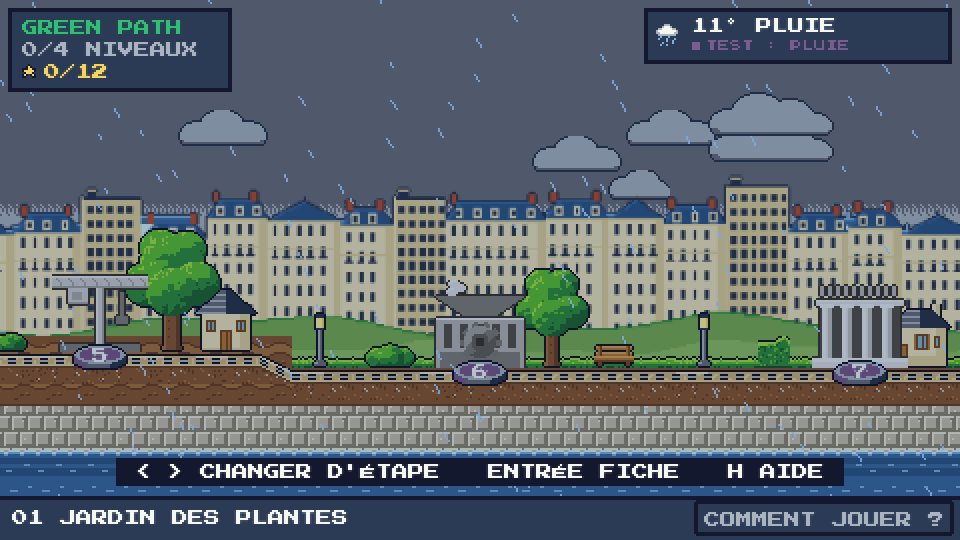

# Green Path — Nantes en mille pixels

> *« Psst… par ici ! Je suis le gardien de la ligne verte. Cette nuit, un grand coup de vent a soufflé sur Nantes. Ses monuments se sont envolés en mille pixels ! »*

Un jeu de plateforme pixel art qui suit la **ligne verte** de Nantes. De lieu en lieu, tu cours, tu sautes et tu ramasses les pixels qui reconstruisent, case après case, **une vraie photo de chaque monument**. Le ciel du jeu suit **la météo réelle de Nantes**, en direct.

**▶ Jouer : https://green-path-sepia.vercel.app** (ordinateur, ou téléphone tenu en paysage)


| La carte du monde | Le premier niveau : le Jardin des Plantes |
|---|---|
|  |  |
| **Il pleut à Nantes ? Il pleut sur la carte.** | **Sur téléphone, en paysage, avec les boutons tactiles** |
|  |  |

## Le concept
- **Une archive qui se reconstruit** : chaque niveau cache des pixels. Chacun ramassé révèle un morceau de la photo du lieu (48×32 cases, 16 couleurs), dans un ordre propre au lieu : le Jardin des Plantes pousse **du bas vers le haut**, comme une plante.
- **Une ligne verte à suivre** : sur la carte, le chemin s'allume en vert à chaque lieu terminé, et le monument passe du gris à la couleur.
- **Trois étoiles par niveau** : image complète, sans mourir, sous le temps cible.
- **La vraie météo** (Open-Meteo) : jour ou nuit, nuages, pluie, neige, vent. Aujourd'hui l'effet est visuel ; dans la prochaine version, chaque niveau aura sa règle météo (pluie = les ronces poussent, soleil = des fleurs deviennent des plateformes…), toujours annoncée et jamais bloquante.
- **Ton avatar** : coiffure, yeux, peau, tenue, chaussures, ou un des 8 modèles.

## Les 12 lieux
L'ordre suit le game design du projet : **ce n'est pas la numérotation officielle de la ligne verte du Voyage à Nantes.**

| # | Lieu | Statut |
|---|---|---|
| 1 | Jardin des Plantes | ✅ jouable |
| 2 | Cathédrale Saint-Pierre-et-Saint-Paul | 🚧 en construction |
| 3 | Château des ducs de Bretagne | 🚧 en construction |
| 4 | Île Feydeau | 🚧 en construction |
| 5 | Grue Titan | à venir |
| 6 | Éléphant des Machines de l'île | à venir |
| 7 | Place Graslin | à venir |
| 8 | Anneaux de Buren | à venir |
| 9 | Hangar à Bananes | à venir |
| 10 | Passage Pommeraye *(provisoire)* | à venir |
| 11 | Mémorial de l'abolition de l'esclavage *(provisoire)* | à venir |
| 12 | Tour LU *(provisoire)* | à venir |

## Commandes
| Carte | Niveau |
|---|---|
| ← → ou A D : lieu précédent / suivant | ← → ou Q/A D : courir |
| Entrée / Espace : fiche du lieu, JOUER | Espace, ↑, W ou Z : sauter (maintenir = plus haut) |
| Clic sur un piédestal : y aller | Échap : pause (reprendre, aide, quitter) |
| H ou **COMMENT JOUER ?** : aide en 4 pages | Téléphone : ← → ↓ et saut à l'écran, bouton PAUSE |
| Échap : menu · M : son | Ronce ou chute = une mort, retour à la dernière lanterne |

Sur téléphone, le jeu se joue **en paysage** : tenu en portrait, un écran demande de le tourner et le jeu se met en pause.

## Lancer en local
Aucun build, aucune dépendance : ouvrir `index.html` dans un navigateur (fonctionne en `file://`), ou servir le dossier :
```bash
python3 -m http.server 8123
```
puis http://localhost:8123. **Mode test** : ajouter `?dev=1` à l'adresse (W : météos simulées sur la carte, N dans un niveau ; K : ramasser tous les pixels).

## Fallback et limites connues
- **Hors ligne, le jeu reste entièrement jouable** : la météo passe sur des valeurs de secours neutres (affichées « HORS LIGNE »), la progression est gardée dans le navigateur (`localStorage`).
- La météo est mise en cache 30 min (« IL Y A N MIN ») pour ne pas rappeler l'API à chaque écran.
- Un seul niveau jouable pour l'instant ; les niveaux 2 à 4 arrivent avec le moteur de mécaniques (escalade, accroupi, plateformes mobiles) et les règles météo.

## Stack
Phaser 3.90 (inclus en local), JavaScript natif en scripts classiques (pas de build, compatible `file://`), police Press Start 2P, résolution 480×270 agrandie sans lissage. Tout le décor vient de planches de sprites en texte (une lettre = une couleur d'une palette de 35) transformées en textures au démarrage. Déploiement statique sur Vercel.

```
index.html               page, icônes, écran « tournez votre téléphone »
js/config.js             réglages, palette, mode test (?dev=1)
js/data/                 locations.js (12 lieux), levels.js (niveaux), sprites/ (planches importées)
js/systems/              Sprites, MapArt (carte), LevelArt (ciel, décor), WeatherManager / WeatherFX (météo),
                         PixelCollection (photo à reconstruire), Save / Progression / Stars, Ui (fenêtres, aide, tactile)
js/scenes/               Boot, Menu, Character (avatar), Map, Game (moteur de plateforme), Result
assets/                  police, logo et icônes, photos pixélisées (assets/locations/*.js)
tools/                   import-sprites.js, pixelize.swift, favicon.swift, compare-figma.js, bot.js (tests)
```

## Crédits et IA
- **Florine RACINE** — UX/UI Designer, Game Design · **Loan PLEURMEAU** — Développeur web, IA Ops (ESD Nantes, atelier PATRIMOINE.EXE).
- **Usage de l'IA** : le code a été écrit avec Claude Code (Anthropic) sous la direction de l'équipe, qui le relit et sait l'expliquer ; les planches de sprites de décor ont été générées avec Claude Design puis importées telles quelles ; le sprite de l'avatar vient du fichier Figma de l'équipe.
- Photo du Palmarium : Pymouss44, CC BY-SA 3.0, via Wikimedia Commons, recadrée et pixélisée. Données météo : Open-Meteo (CC BY 4.0). Police Press Start 2P (OFL). Phaser (MIT).
- Détails, licences et obligations : [CREDITS.md](CREDITS.md).
